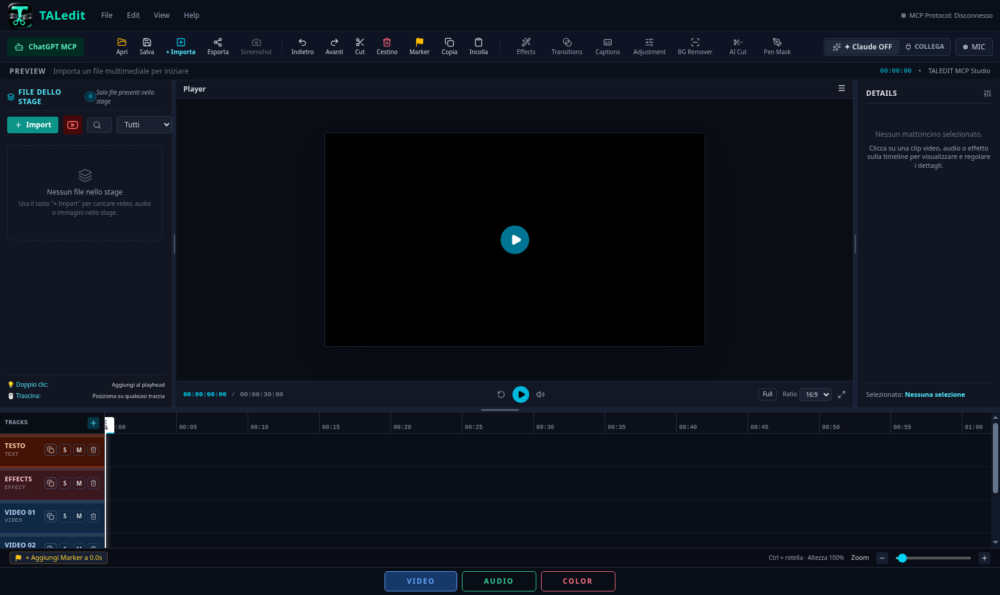

# Recupero della versione completa TALedit

La base applicativa è `0796d05c4887cd4ec3726bbde6a24f240a6baf4a`, ultimo commit del
ramo `codex/taledit-export-mcp-whisper` al momento del recupero del 13 novembre 2026.
La precedente distribuzione Electron da `main` era basata sulla bozza `7dff149`
e non conteneva gli sviluppi di questo ramo.

## Corrispondenza con l'interfaccia di riferimento

Conservati ChatGPT MCP e Claude MCP, Apri/Salva/Importa/Esporta, Screenshot,
Undo/Redo, Cut, Cestino, Marker, Copia/Incolla, Effects, Transitions, Captions,
Adjustment, BG Remover, AI Cut e Pen Mask, pannelli VIDEO/AUDIO/COLOR,
tracce TESTO/EFFECTS/VIDEO/AUDIO/IMMAGINI, stage, player e dettagli.

I sorgenti dell'editor e del server sono ripresi integralmente dalla base completa.
Nel frontend sono cambiati soltanto il marchio in TopNav e gli import dei font locali;
non sono state ricostruite le funzionalità a partire dalla bozza incompleta.

## Distribuzione

Si mantiene il payload offline già esistente: Node.js, Python privato, FFmpeg/ffprobe,
yt-dlp, Whisper small, U2NetP e relative dipendenze. Electron ospita la stessa UI e
le stesse API; non sostituisce il backend. Installer, launcher EXE, collegamenti e
interfaccia usano lo stesso logo, con ICO multirisoluzione.

La pubblicazione avviene solo dopo i controlli Windows già previsti: payload,
installazione reale, runtime nativi, inferenza Whisper/U2NetP, importazione,
esportazione, screenshot, riproduzione con immagine e suono, disinstallazione con
conservazione dei dati. Sono aggiunti controlli sulla finestra Electron reale e
sulla presenza del logo e di tutti i gruppi di comandi del riferimento.

## Dati personali

Il pacchetto completo mantiene i dati in `%LOCALAPPDATA%\TALEDIT\data`.
Chi ha usato la precedente distribuzione Electron incompleta può trovare i media
in `%APPDATA%\TALedit\media_downloads`: conservarli e copiarli nella cartella dati
completa se necessari per riaprire i progetti. Nessuna cartella personale viene
cancellata o spostata automaticamente da questa correzione.

## Verifiche locali prima del commit

- 61 file applicativi confrontati con `0796d05`: 59 identici byte per byte;
  modifiche soltanto a `TopNav.tsx` (marchio) e `index.css` (font locali).
- 130 test applicativi superati, con modelli reali recuperati dalla precedente
  Release completa e verificati contro gli hash SHA256 bloccati.
- Prove browser su controlli, mixer, colore, maschere, sottotitoli, MCP, formati,
  BG Remover e riproduzione, incluso MOV da 4433,7 secondi e HEVC 4K a 8/10 bit.
- Avvio reale in Electron su Linux: finestra completa, logo caricato e chiusura.
- Build TypeScript/Vite e controlli sintattici dei componenti del pacchetto.

I test browser precedenti avevano tre aspettative obsolete: stato non isolato tra
file di test, vecchio nome del comando di collegamento e selettore non univoco per
gli errori. Corrette le verifiche senza cambiare il comportamento dell'editor.
Le prove Windows sull'installer sono eseguite dalla pipeline e bloccano la Release
in caso di errore; l'avvio Linux non sostituisce queste verifiche.

